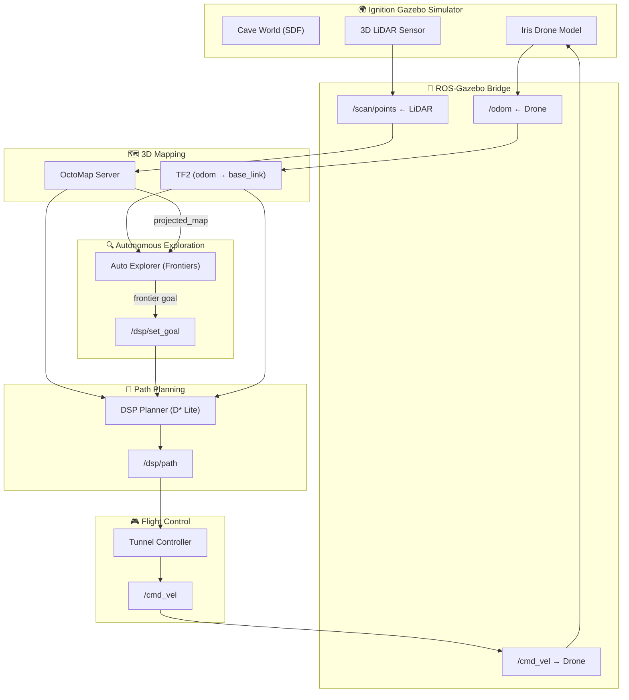

<div align="center">

# 🚁 OA-Drone — Obstacle-Avoidance Drone for Autonomous Cave Exploration

[](https://docs.ros.org/en/humble/)
[](https://releases.ubuntu.com/22.04/)
[](https://gazebosim.org/)
[](LICENSE)

**An autonomous drone system that navigates and explores cave/tunnel environments using 3D path planning and frontier-based exploration.**

**طائرة بدون طيار ذاتية القيادة تستكشف الكهوف والأنفاق باستخدام تخطيط مسار ثلاثي الأبعاد واستكشاف قائم على الحدود (Frontier-Based Exploration).**

</div>

---

## 📋 Table of Contents

- [Overview](#overview)
- [Architecture](#architecture)
- [Packages](#packages)
- [Requirements](#requirements)
- [Installation](#installation)
- [Usage](#usage)
- [Project Structure](#project-structure)
- [Configuration](#configuration)
- [License](#license)

---

## 🔍 Overview

OA-Drone is a ROS2-based autonomous exploration system designed for GPS-denied environments such as caves, tunnels, and mines. The drone:

1. **Maps** its surroundings in real-time using a 3D LiDAR sensor and OctoMap
2. **Plans** collision-free paths through a 3D voxel grid using the DSP (D* Search Planner) algorithm
3. **Explores** autonomously by detecting frontiers (boundaries between known and unknown space)
4. **Avoids obstacles** in real-time while maintaining safe altitude and wall distance

### نظرة عامة (Arabic)

نظام OA-Drone هو نظام استكشاف ذاتي مبني على ROS2، مصمم للبيئات المُغلقة والخالية من GPS مثل الكهوف والأنفاق والمناجم. تقوم الطائرة بـ:
- رسم خريطة ثلاثية الأبعاد للبيئة المحيطة في الوقت الحقيقي
- تخطيط مسارات آمنة لتجنب العوائق
- الاستكشاف الذاتي بالبحث عن حدود الفراغات غير المستكشفة
- تجنب الاصطدام بالجدران والعوائق ديناميكياً

---

## 🏗️ Architecture



---

## 📦 Packages

| Package | Type | Description |
|---------|------|-------------|
| `drone` | Simulation | Iris quadrotor model (SDF), sensors, and ROS-Gazebo bridge configuration |
| `sim_bringup` | Simulation | Launch files for spawning the drone in Gazebo |
| `sim_worlds` | Simulation | Cave/tunnel world models with 3D meshes and textures |
| `dsp` | Path Planning | 3D D*-Lite path planner with OctoMap integration |
| `dsp_interfaces` | Path Planning | Custom ROS2 service definitions for path cost queries |

### Standalone Scripts (`run_scripts/`)

| Script | Description |
|--------|-------------|
| `auto_explorer.py` | Frontier-based autonomous exploration with stuck detection and goal re-sending |
| `iris_dsp_controller.py` | 3D tunnel flight controller with look-ahead tracking and altitude control |
| `odom_to_tf.py` | Broadcasts odometry data as TF transforms for the mapping pipeline |

---

## ⚙️ Requirements

### System
- **OS:** Ubuntu 22.04 LTS
- **ROS2:** Humble Hawksbill
- **Simulator:** Ignition Gazebo Fortress
- **Python:** 3.10+

### ROS2 Dependencies
```bash
sudo apt install \
  ros-humble-octomap \
  ros-humble-octomap-server \
  ros-humble-octomap-msgs \
  ros-humble-tf2-ros \
  ros-humble-ros-gz-bridge \
  ros-humble-ros-gz-sim
```

---

## 🚀 Installation

### 1. Clone the repository
```bash
cd ~
git clone https://github.com/<YOUR_USERNAME>/oadrone_ws.git
cd oadrone_ws
```

### 2. Install dependencies
```bash
# Install ROS2 dependencies
rosdep install --from-paths src --ignore-src -r -y
```

### 3. Build the workspace
```bash
source /opt/ros/humble/setup.bash
colcon build --symlink-install
source install/setup.bash
```

---

## 🎮 Usage

### One-Command Launch
The easiest way to start the full autonomous exploration mission:

```bash
cd ~/oadrone_ws
source install/setup.bash
./start_mission.sh
```

This will open 5 terminal tabs:
1. **Gazebo** — Simulation environment with the cave world
2. **TF Bridge** — Odometry to TF transform broadcaster
3. **Mapping** — OctoMap server, DSP planner, and RViz visualization
4. **Controller** — 3D flight controller
5. **Explorer** — Autonomous frontier explorer

### Manual Launch (Step by Step)

```bash
# Terminal 1: Launch Gazebo simulation
ros2 launch sim_bringup iris.gazebo.launch.py

# Terminal 2: Start TF bridge
python3 run_scripts/odom_to_tf.py

# Terminal 3: Start mapping and planning
ros2 launch dsp iris_dsp_mapping.launch.py

# Terminal 4: Start flight controller
python3 run_scripts/iris_dsp_controller.py

# Terminal 5: Start autonomous exploration
python3 run_scripts/auto_explorer.py
```

---

## 📁 Project Structure

```
oadrone_ws/
├── src/
│   ├── simulation/
│   │   ├── drone/              # Iris quadrotor model & bridge config
│   │   ├── sim_bringup/        # Launch files
│   │   └── sim_worlds/         # Cave/tunnel world models
│   └── path_planning/
│       └── dsp/
│           └── dsp_ros2/
│               ├── dsp/        # 3D path planner (C++)
│               └── dsp_interface/  # Custom service interfaces
├── run_scripts/
│   ├── auto_explorer.py        # Autonomous frontier explorer
│   ├── iris_dsp_controller.py  # 3D flight controller
│   └── odom_to_tf.py          # Odometry → TF broadcaster
├── start_mission.sh            # One-command mission launcher
├── LICENSE
└── README.md
```

---

## ⚙️ Configuration

### DSP Planner (`src/path_planning/dsp/dsp_ros2/dsp/config/params.yaml`)

| Parameter | Default | Description |
|-----------|---------|-------------|
| `RATE` | `800.0` | Path update rate in milliseconds |
| `risk` | `1` | Safety margin radius (voxels) |
| `spline_step` | `0.1` | Path smoothing resolution |
| `update_rate` | `1` | Map update interval (seconds) |

### Flight Controller (`run_scripts/iris_dsp_controller.py`)

| Parameter | Default | Description |
|-----------|---------|-------------|
| `DEFAULT_ALTITUDE` | `0.8` | Hover altitude (meters) |
| `MAX_SPEED` | `0.8` | Maximum forward speed (m/s) |
| `LOOK_AHEAD_DIST` | `1.0` | Path look-ahead distance (meters) |
| `LATERAL_GAIN` | `2.5` | Lateral correction gain |
| `VERTICAL_GAIN` | `1.5` | Altitude correction gain |

### Explorer (`run_scripts/auto_explorer.py`)

| Parameter | Default | Description |
|-----------|---------|-------------|
| `ACCEPTANCE_RADIUS` | `2.5` | Goal reached threshold (meters) |
| `SAFETY_RADIUS_BLOCKS` | `2` | Min free blocks around target |

---

## 📸 Screenshots

<!-- Add your screenshots here -->
<!--  -->
<!--  -->

*Screenshots coming soon — contributions welcome!*

---

## 🤝 Contributing

Contributions are welcome! Please feel free to submit a Pull Request.

1. Fork the repository
2. Create your feature branch (`git checkout -b feature/amazing-feature`)
3. Commit your changes (`git commit -m 'Add amazing feature'`)
4. Push to the branch (`git push origin feature/amazing-feature`)
5. Open a Pull Request

---

## 📄 License

This project is licensed under the MIT License — see the [LICENSE](LICENSE) file for details.

---

<div align="center">

**Built with ❤️ using ROS2 Humble & Ignition Gazebo**

</div>
