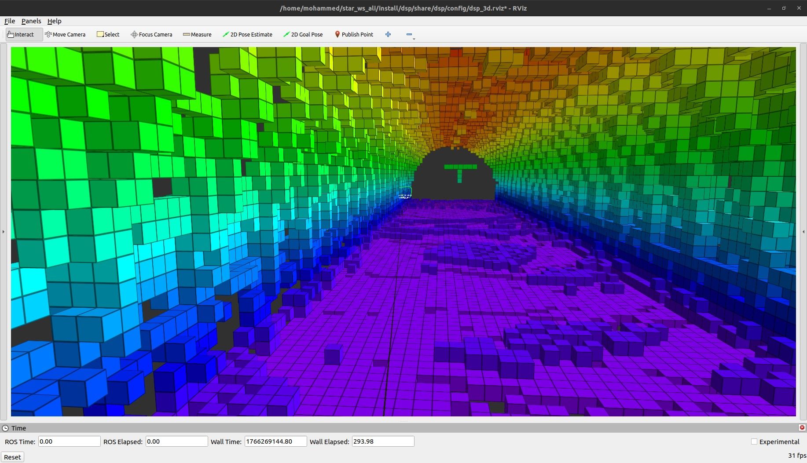
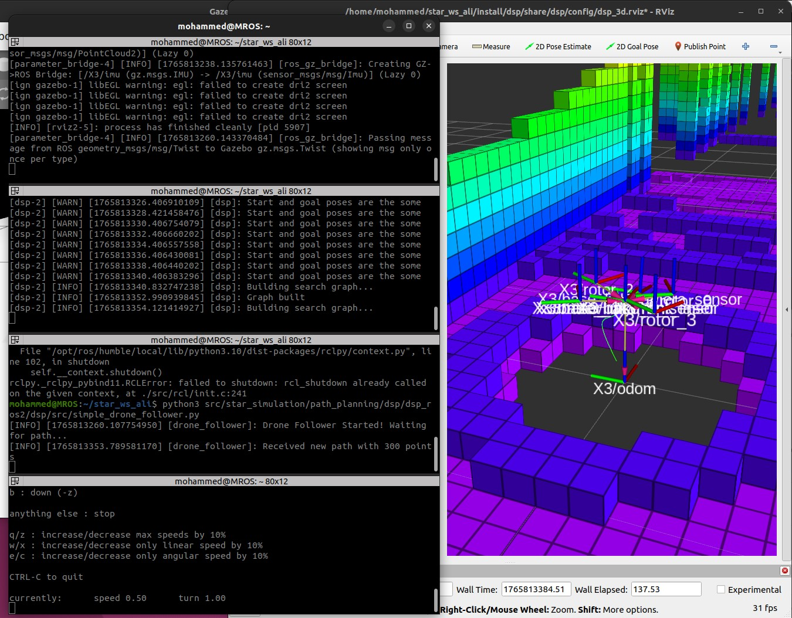
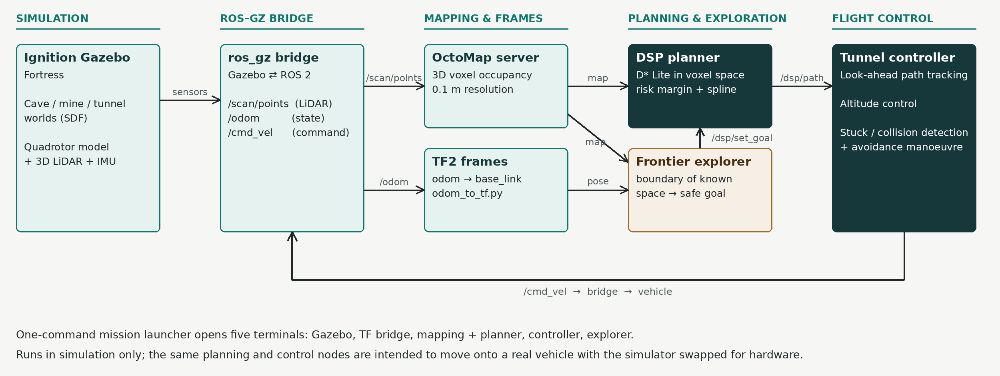
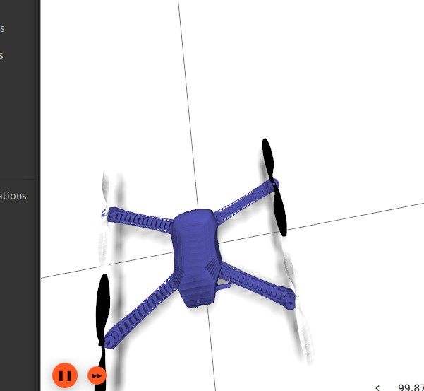
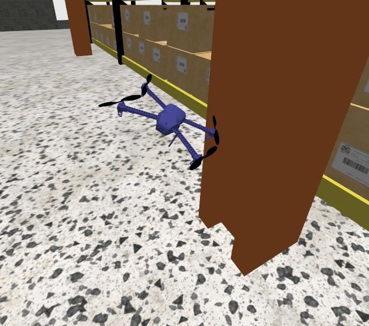
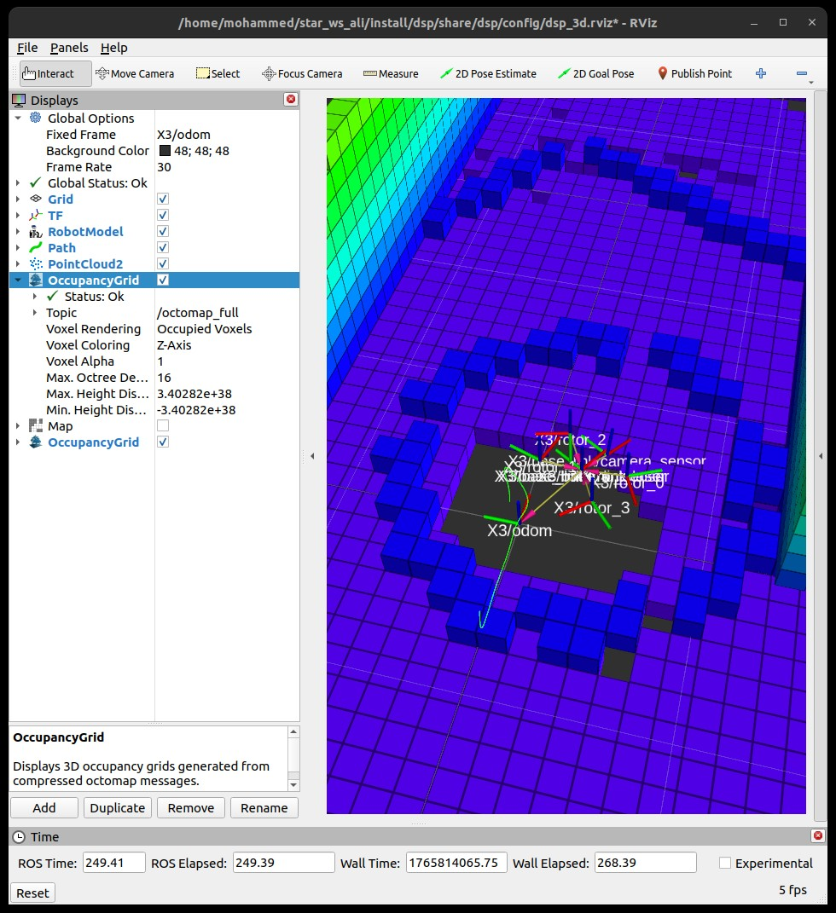

<div align="center">

# OA-Drone: Autonomous Cave Exploration & Obstacle Avoidance

[](https://docs.ros.org/en/humble/)
[](https://releases.ubuntu.com/22.04/)
[](https://gazebosim.org/)
[](LICENSE)

**The autonomy stack for a quadrotor that explores GPS-denied caves, tunnels and mines on its own: it maps in 3D, plans a collision-free path, chooses where to explore next and flies the path without touching the walls.**

📄 **Project page:** [bajhaw.com/projects/autonomous-cave-exploration-drone](https://bajhaw.com/projects/autonomous-cave-exploration-drone)

<br>
<em>The tunnel as the drone sees it: a 3D map built live from LiDAR, coloured by height.</em>

</div>

---

## Contents

- [Overview](#overview)
- [How it works](#how-it-works)
- [Architecture](#architecture)
- [Packages and scripts](#packages-and-scripts)
- [Requirements](#requirements)
- [Installation](#installation)
- [Usage](#usage)
- [Configuration](#configuration)
- [Project status](#project-status)
- [Acknowledgements](#acknowledgements)
- [License](#license)

---

## Overview

A drone flying through a cave cannot use GPS, cannot rely on light, and has walls only a metre or two away on every side. OA-Drone gives a quadrotor carrying a 3D LiDAR the software to cope with that: it builds a 3D map while it flies, plans a safe route through that map, picks the next area to explore and steers along the route by itself.

The system is built on **ROS 2 Humble** and **Ignition Gazebo Fortress** and has been developed and tested in simulation.

## How it works

1. **Mapping:** the 3D LiDAR point cloud feeds **OctoMap**, which turns raw laser points into a voxel grid of free and occupied space (15 cm cells by default).
2. **Planning:** a **D\*-based 3D planner** (DSP) searches that grid for a collision-free route and repairs it incrementally when new obstacles appear instead of replanning from scratch.
3. **Exploring:** a **frontier explorer** finds the boundary between mapped and unknown space, picks a safe point on it and sends it to the planner as the next goal.
4. **Flying:** a **tunnel controller** follows the path with look-ahead tracking, holds a safe altitude and keeps away from the walls.

### Staying out of trouble

Caves are full of dead ends, so the system is designed to notice problems and recover:

- The planner keeps a safety margin around every obstacle and smooths the path to avoid sharp turns.
- The explorer rejects frontier targets that sit too close to a wall.
- If the drone is commanded to move but barely moves for a couple of seconds, it stops, reverses and turns to give the LiDAR a new view, then replans.

<p align="center">
  <br>
  <em>A mission in progress: the 3D map in RViz, with the planner and flight-controller terminals alongside.</em>
</p>

## Architecture

<p align="center">
  <br>
  <em>The simulator and bridge feed mapping, the planner and explorer decide where to go, and the controller turns the path into flight commands.</em>
</p>

Data flow: the LiDAR point cloud (`/scan/points`) builds the OctoMap → the explorer sends frontier goals to the planner (`/dsp/set_goal`) → the planner publishes `/dsp/path` → the controller converts it to `/cmd_vel` for the drone.

### Maps and test worlds

The map is stored as voxels, so the planner works with solid obstacles instead of millions of raw laser points.

<table>
  <tr>
    <td width="50%"></td>
    <td width="50%"></td>
  </tr>
  <tr>
    <td><em>Occupied space around the drone, close up.</em></td>
    <td><em>The simulated quadrotor in one of the test worlds.</em></td>
  </tr>
</table>

## Packages and scripts

### ROS 2 packages (`src/`)

| Package | Role | Description |
|---|---|---|
| `drone` | Simulation | Iris quadrotor model (SDF), sensors and ROS-Gazebo bridge configuration |
| `sim_bringup` | Simulation | Launch files that spawn the drone in Gazebo |
| `sim_worlds` | Simulation | Test worlds: cave, mine, collapsed building, warehouse, office and more |
| `dsp` | Path planning | 3D D\* planner with OctoMap integration |
| `dsp_interfaces` | Path planning | Custom ROS 2 service definitions for path-cost queries |

### Mission scripts (`run_scripts/`)

| Script | Description |
|---|---|
| `auto_explorer.py` | Frontier-based exploration with stuck detection and goal re-sending |
| `iris_dsp_controller.py` | 3D tunnel-flight controller with look-ahead tracking and altitude hold |
| `odom_to_tf.py` | Publishes odometry as TF transforms for the mapping pipeline |

## Requirements

- **OS:** Ubuntu 22.04 LTS
- **ROS 2:** Humble Hawksbill
- **Simulator:** Ignition Gazebo Fortress
- **Python:** 3.10+

```bash
sudo apt install \
  ros-humble-octomap \
  ros-humble-octomap-server \
  ros-humble-octomap-msgs \
  ros-humble-tf2-ros \
  ros-humble-ros-gz-bridge \
  ros-humble-ros-gz-sim
```

## Installation

The launch scripts expect the workspace at `~/oadrone_ws`.

```bash
# 1. Clone into the expected workspace folder
git clone https://github.com/MohammedBajhaw/drone-navigation.git ~/oadrone_ws
cd ~/oadrone_ws

# 2. Build and install the DSL search library used by the planner
cd src/path_planning/dsp/dsl
mkdir -p build && cd build
cmake .. && sudo make install
cd ~/oadrone_ws

# 3. Install ROS dependencies and build the workspace
source /opt/ros/humble/setup.bash
rosdep install --from-paths src --ignore-src -r -y
colcon build --symlink-install
source install/setup.bash
```

## Usage

### One-command mission

```bash
cd ~/oadrone_ws
source install/setup.bash
./start_mission.sh [world]
```

`world` selects the environment (default: `cave`):

| Option | World |
|---|---|
| `cave` | Custom cave (default) |
| `mine` | Edgar mine |
| `disaster` | Disaster mine rescue scenario |
| `house` / `ruins` | Collapsed building |
| `warehouse` | Warehouse |
| `office` | Office |
| `room` | Experimental room |
| `gas` | Gas station |
| `park` | Playground park |
| `fire` | Collapsed fire station |

The script opens five terminal tabs: **Gazebo**, **TF bridge**, **Mapping** (OctoMap, planner and RViz), **Controller** and **Explorer**.

<p align="center">
  <br>
  <em>The RViz setup used during development: occupancy grid, planned path and coordinate frames.</em>
</p>

### Manual launch

```bash
# Terminal 1: simulation
ros2 launch sim_bringup iris.gazebo.launch.py

# Terminal 2: odometry → TF
python3 run_scripts/odom_to_tf.py

# Terminal 3: mapping and planning
ros2 launch dsp iris_dsp_mapping.launch.py

# Terminal 4: flight controller
python3 run_scripts/iris_dsp_controller.py

# Terminal 5: autonomous exploration
python3 run_scripts/auto_explorer.py
```

## Configuration

### Mapping (`src/path_planning/dsp/dsp_ros2/dsp/launch/iris_dsp_mapping.launch.py`)

| Parameter | Default | Description |
|---|---|---|
| `resolution` | `0.15` | OctoMap voxel size (m) |
| `sensor_model/max_range` | `8.0` | Maximum LiDAR range used for mapping (m) |
| `occupancy_min_z` / `occupancy_max_z` | `0.2` / `5.0` | Height band kept in the map (m) |

### Planner (`src/path_planning/dsp/dsp_ros2/dsp/config/params.yaml`)

| Parameter | Default | Description |
|---|---|---|
| `RATE` | `800.0` | Path update period (ms) |
| `risk` | `1` | Safety margin around obstacles (voxels) |
| `spline_step` | `0.1` | Path smoothing resolution |
| `update_rate` | `1` | Map update interval (s) |

### Flight controller (`run_scripts/iris_dsp_controller.py`)

| Parameter | Default | Description |
|---|---|---|
| `DEFAULT_ALTITUDE` | `0.8` | Hover altitude (m) |
| `MAX_SPEED` | `0.8` | Maximum forward speed (m/s) |
| `LOOK_AHEAD_DIST` | `1.0` | Path look-ahead distance (m) |
| `LATERAL_GAIN` | `2.5` | Lateral correction gain |
| `VERTICAL_GAIN` | `1.5` | Altitude correction gain |

### Explorer (`run_scripts/auto_explorer.py`)

| Parameter | Default | Description |
|---|---|---|
| `ACCEPTANCE_RADIUS` | `2.0` | Distance at which a goal counts as reached (m) |
| `SAFETY_RADIUS_BLOCKS` | `3` | Minimum free cells required around a frontier target |

## Project status

This is a **simulation project**. The repository documents the system and its tuning values, but there is no formal benchmark of success rate or area covered, so none is claimed. Planning and control are independent of the simulator, so moving to a real vehicle means replacing the simulated sensors and flight interface.

## Acknowledgements

- The planner is based on [**dsp_ros2**](https://github.com/alitekes1/dsp_ros2) (@alitekes1).
- It uses the [**DSL**](https://github.com/jhu-asco/dsl) D\* search library by Marin Kobilarov and Matt Sheckells (Johns Hopkins University), distributed under the Mozilla Public License 2.0 (see `src/path_planning/dsp/dsl/LICENSE`).

## License

This project is released under the MIT License (see [LICENSE](LICENSE)). Third-party components keep their original licenses.
