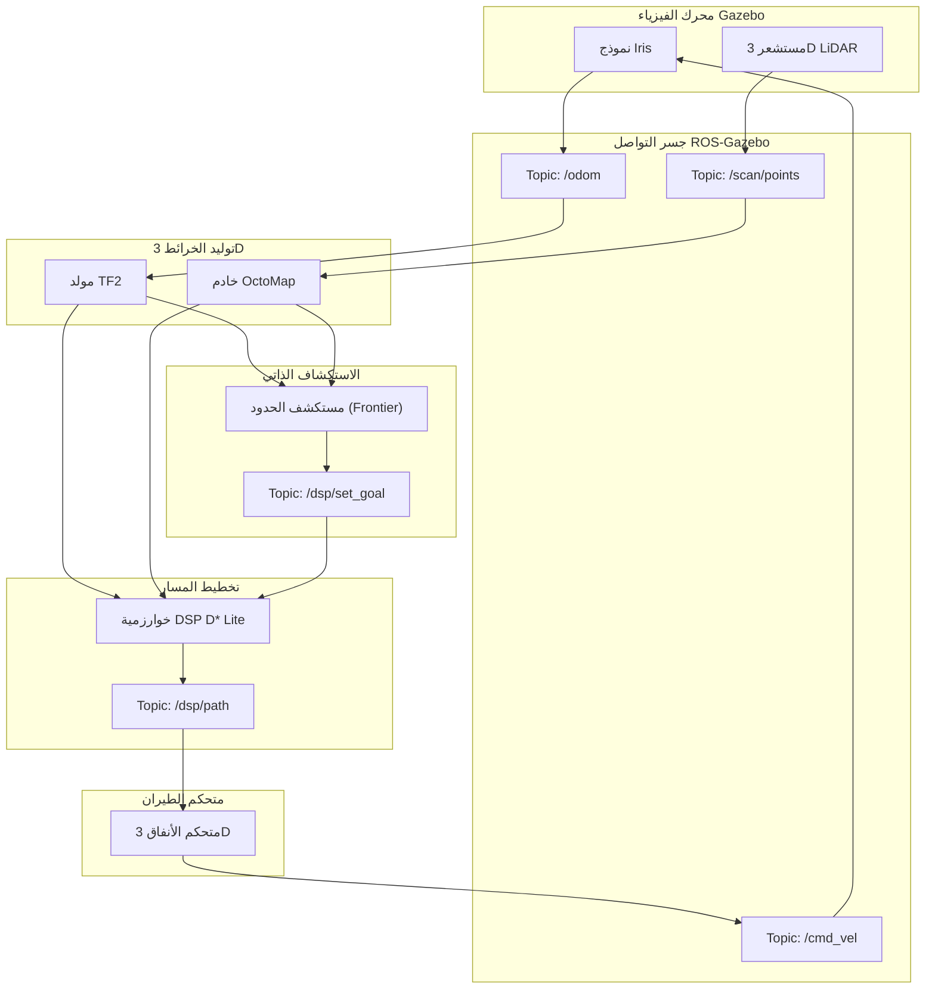

# التقرير التفصيلي والشامل لمشروع الطائرة المسيرة لتجنب العوائق (OA-Drone)

---

## جدول المحتويات
1. [المقدمة والملخص التنفيذي](#المقدمة-والملخص-التنفيذي)
2. [الأهداف الرئيسية للمشروع](#الأهداف-الرئيسية-للمشروع)
3. [الخلفية التقنية وتاريخ التطوير](#الخلفية-التقنية-وتاريخ-التطوير)
4. [هيكلية النظام العامة ومخطط ROS2](#هيكلية-النظام-العامة-ومخطط-ros2)
5. [بيئة المحاكاة (Ignition Gazebo) التفصيلية](#بيئة-المحاكاة-ignition-gazebo-التفصيلية)
6. [نظام الخرائط ثلاثي الأبعاد (OctoMap)](#نظام-الخرائط-ثلاثي-الأبعاد-octomap)
7. [خوارزمية تخطيط المسار (DSP Planner)](#خوارزمية-تخطيط-المسار-dsp-planner)
8. [نظام التحكم في الطيران (Tunnel Controller)](#نظام-التحكم-في-الطيران-tunnel-controller)
9. [خوارزمية الاستكشاف الذاتي (Frontier Explorer)](#خوارزمية-الاستكشاف-الذاتي-frontier-explorer)
10. [شرح سكربتات التشغيل التفصيلية](#شرح-سكربتات-التشغيل-التفصيلية)
11. [دليل المتغيرات والإعدادات (Parameters)](#دليل-المتغيرات-والإعدادات-parameters)
12. [استكشاف الأخطاء وإصلاحها (Troubleshooting)](#استكشاف-الأخطاء-وإصلاحها-troubleshooting)
13. [الخاتمة والتطلعات المستقبلية](#الخاتمة-والتطلعات-المستقبلية)

---

## 1. المقدمة والملخص التنفيذي

مشروع **OA-Drone** هو نظام روبوتي متقدم لطائرة بدون طيار (UAV) مصمم للعمل في ظروف بيئية قاسية ومعقدة، وتحديداً في الأماكن المغلقة التي تنعدم فيها إشارات تحديد المواقع العالمية (GPS-Denied Environments) مثل الكهوف الطبيعية العميقة، والأنفاق تحت الأرض، والمناجم، أو حتى المباني المنهارة نتيجة الكوارث الطبيعية. 

يعتمد المشروع على نظام التشغيل الآلي الحديث (ROS2 Humble) ويستفيد من قوة محاكي (Ignition Gazebo Fortress) لمحاكاة ديناميكا الطيران واستجابة المستشعرات قبل التطبيق الفعلي. يجمع النظام بين مجموعة واسعة من الخوارزميات المتقدمة، بدءاً من بناء الخرائط ثلاثية الأبعاد (3D Mapping) باستخدام `OctoMap`، وتخطيط المسارات التفاعلي باستخدام خوارزمية البحث المتقدمة (D* Lite)، ووصولاً إلى وحدة التحكم الذاتية التي تطبق مفهوم التتبع الاستباقي (Look-Ahead Control) للحفاظ على سلاسة الحركة وتجنب العوائق الجدارية.

---

## 2. الأهداف الرئيسية للمشروع

تم بناء هذا المشروع وتصميمه بناءً على أهداف رئيسية متمثلة في الآتي:
- **التنقل الذاتي بالكامل:** تقليل الاعتماد على التحكم البشري إلى الصفر، بحيث يتم إرسال الطائرة إلى مدخل الكهف لتتولى هي بنفسها اتخاذ القرارات الملاحية.
- **تجنب العوائق الديناميكي واللحظي:** القدرة على اكتشاف الصخور والأعمدة المفاجئة وتغيير المسار بشكل لحظي لمنع الاصطدام.
- **الرؤية المكانية ثلاثية الأبعاد:** تحويل البيانات الخام المأخوذة من تقنية الـ LiDAR إلى مجسمات حجمية (Voxel Grids) تمثل العالم بدقة.
- **الاستكشاف الذاتي:** عدم الاكتفاء بالطيران من نقطة أ إلى ب، بل البحث عن المناطق "المجهولة" وتوجيه الطائرة نحوها لإنهاء مسح الخريطة (Frontier Exploration).
- **الاستقرار والاعتمادية:** منع حدوث أي انهيار في النظام (Crash) عبر فصل المهام إلى عقد مستقلة (Nodes) تتواصل عبر رسائل قياسية.

---

## 3. الخلفية التقنية وتاريخ التطوير

تمثل هذه النسخة من المشروع "الدماغ البرمجي" المتكامل لمهام البحث والإنقاذ (Search & Rescue). يمكن نقل هذا النظام لاحقاً إلى هيكل مادي، حيث يتم استبدال محاكي Gazebo بالعتاد المادي والطائرة الحقيقية، وتبقى الخوارزميات (الخرائط، التخطيط، والتحكم) تعمل بنفس الكفاءة العالية للتنقل في الكهوف والمناطق الوعرة.

---

## 4. هيكلية النظام العامة ومخطط ROS2

### المفهوم المعماري
نظام ROS2 المطبق يعتمد على فك الارتباط (Decoupling). العقدة المسؤولة عن الخرائط لا تتدخل في التحكم، والعقدة المسؤولة عن التحكم لا تكترث من أين جاء المسار، طالما أنه آمن. هذا يسمح بتبديل المكونات بسهولة، مثلاً تغيير المخطط دون لمس وحدة التحكم.

### رسم توضيحي لتفاعل العقد والمواضيع (Nodes and Topics)



### شرح مفصل للعقد الأساسية
1. **جسر ROS-Gazebo (`ros_gz_bridge`)**: يعمل كمترجم، حيث يقوم بنقل الرسائل من بروتوكول محاكي Ignition إلى بروتوكول ROS2 المعتمد (DDS).
2. **عقدة الخرائط (`octomap_server`)**: تستقبل ملايين النقاط وتلخصها في شبكة مكعبات لتسهيل معالجتها.
3. **عقدة التخطيط (`dsp_planner`)**: تستلم الخريطة ونقطة الهدف، وتقوم بعمليات رياضية معقدة لضمان وجود مسار خالٍ من أي اصطدام.
4. **عقدة التحكم (`tunnel_controller`)**: تترجم هذا المسار المعقد إلى أرقام وسرعات بسيطة تفهمها المحركات.

---

## 5. بيئة المحاكاة (Ignition Gazebo) التفصيلية

المحاكاة ليست مجرد ألعاب، بل هي بيئة رياضية صارمة تختبر الكود قبل المخاطرة بطائرة حقيقية باهظة الثمن.

### 5.1. لماذا Ignition Gazebo Fortress؟
الجيل الجديد من Gazebo يقدم محركات فيزيائية حديثة مثل (Dart) ويتعامل بكفاءة عالية جداً مع حساسات الـ LiDAR واسعة النطاق التي تستهلك المعالج عادة في الإصدارات القديمة.

### 5.2. سيناريوهات الاختبار (Simulation Worlds)
تم بناء المشروع ليحتوي على بيئات شاملة لكل حالات الطوارئ الممكنة. نذكر منها:
- **custom_cave.sdf**: الكهف المخصص، يحتوي على تضاريس خشنة جداً وغير مستوية، تختبر قدرة الطائرة على تغيير الارتفاع.
- **edgar_mine.sdf**: منجم إدغار الشهير، يحتوي على ممرات طويلة ومظلمة تختبر مشكلة "الانحراف" (Drift) في حسابات الموقع.
- **disaster_fire_station.sdf**: مبنى إطفاء منهار يعج بالدعامات المعدنية الرفيعة التي يصعب على الـ LiDAR رصدها.
- **tugbot_warehouse.sdf**: مستودع صناعي ضخم لاختبار الاستكشاف في الأماكن شبه المفتوحة وسرعة استجابة المخطط.
- **disaster_gas.sdf**: محطة وقود، تجمع بين التنقل الخارجي والانتقال إلى داخل مبنى المحطة والمتاجر المرافقة.

### 5.3. نموذج الطائرة (Iris Quadrotor)
يتم استخدام طراز "Iris" لأنه طراز قياسي ومثبت الكفاءة، وقد تمت إضافة مستشعرات دقيقة في ملف تصميمه (`URDF`/`SDF`):
- كاميرا عمق / LiDAR محيطي بمدى 360 درجة أفقي لتوفير زاوية رؤية شاملة وتجنب العوائق من الجوانب والخلف.
- وحدة قياس القصور الذاتي (IMU) بتردد عالي لرصد أدق التفاصيل في الميلان والسرعة.

---

## 6. نظام الخرائط ثلاثي الأبعاد (OctoMap)

للطيران الذاتي الحقيقي، لا تكفي الخرائط ثنائية الأبعاد (2D Occupancy Grids) بل نحتاج إلى تمثيل حجمي حقيقي.

### 6.1. نظرية الشجرة الثمانية (Octree)
البيانات القادمة من הـ LiDAR تكون على شكل سحابة نقطية (Point Cloud) تحتوي على إحداثيات (x, y, z) لملايين النقاط. تخزين هذه النقاط غير فعال، لذلك يقوم `OctoMap` بتقسيم العالم إلى مكعب رئيسي ضخم. إذا كان المكعب به نقطة أو جدار، يتم قسمته إلى 8 مكعبات أصغر، وهكذا حتى نصل للحد الأدنى من دقة الخريطة (Resolution)، والذي حددناه بـ `0.1` متر (10 سم).

### 6.2. الاحتمالية الرياضية للتأكد من العوائق
لا يقوم النظام بتصديق شعاع ليزر واحد، بل يعتمد على معادلة الاحتماليات التراكمية (Log-Odds):
- عندما يضرب الشعاع نقطة، ترتفع احتمالية إشغالها (Hit Probability).
- المساحة بين المستشعر والنقطة المضروبة تعتبر مساحة حرة (Miss Probability) ويتم خفض احتمالية الإشغال فيها.
هذه الميزة تقضي تماماً على التشويش وأخطاء المستشعرات (Sensor Noise)، وتضمن أن العوائق التي يراها المخطط موجودة بالفعل.

### 6.3. التحويلات الفراغية (TF Broadcaster)
لكي يتم رسم النقطة في مكانها الصحيح في الخريطة العالمية `map`، يجب معرفة أين كانت الطائرة `base_link` بالضبط لحظة التقاط النقطة، وذلك بالنسبة لمرجع البداية `odom`. يقوم سكربت `odom_to_tf.py` بحل هذه المشكلة الجوهرية.

---

## 7. خوارزمية تخطيط المسار (DSP Planner)

هذا الجزء هو الذي يمنح النظام "الذكاء". المخطط مبني لتجاوز خوارزميات مثل (A*) و (Dijkstra) الثقيلة رياضياً.

### 7.1. تقنية D* Lite في ثلاثية الأبعاد
تعتبر خوارزمية D* Lite من أكثر الخوارزميات كفاءة في الملاحة الديناميكية الروبوتية. آلية العمل:
- تبدأ حساب التكلفة (Cost) من الهدف رجوعاً للطائرة، وليس العكس.
- تحتفظ بالخريطة السابقة في الذاكرة.
- بمجرد رصد عائق جديد يسد المسار المحسوب، الخوارزمية **لا تعيد الحساب من الصفر**، بل تقوم فقط بتحديث قيم النقاط المجاورة للعائق، مما يقلل الوقت الحسابي لأجزاء من الألف من الثانية، وهو ما يتيح للطائرة سرعة رد الفعل.

### 7.2. هوامش الأمان والمخاطرة (Risk Margin)
تم ضبط المتغير `risk: 1` في إعدادات المخطط `params.yaml`. هذا يعني أنه عند تخطيط مسار يمر بجانب حائط، فإن المخطط سيفرض "هالة وهمية" (Inflation Radius) بمقدار مكعب واحد حول الحائط ليعتبره منطقة محرمة. هذا يقي الطائرة من الاحتكاك بالجدران الصخرية غير المستوية في الكهف.

### 7.3. تنعيم المسارات (B-Splines)
خوارزميات البحث التقليدية تنتج مسارات حادة ومنكسرة (Zig-Zag). الطائرات لا يمكنها الالتفاف بزاوية 90 درجة فورياً دون أن تفقد توازنها. لذا يتم تمرير المسار على منعم `spline_step: 0.1` ليحوله إلى منحنى انسيابي مثالي للطيران السلس.

---

## 8. نظام التحكم في الطيران (Tunnel Controller)

السكربت المخصص في `iris_dsp_controller.py` هو حلقة الوصل الأخيرة التي تنفذ المسار المنعم على المحركات وتمنع الطائرة من التأرجح.

### 8.1. المتحكم الاستباقي (Look-Ahead Controller)
لا تتبع الطائرة النقطة الأقرب لها في المسار المخطط، بل "تنظر للأمام" عبر المتغير `LOOK_AHEAD_DIST = 1.0`. هذا أشبه بسائق سيارة متمرس لا ينظر للمقدمة المباشرة لسيارته، بل للمنعطف القادم ليحضر مقود السيارة للالتفاف بشكل تدريجي.

### 8.2. التحليل الرياضي لزوايا التوجيه
يقوم المتحكم بتحويل إحداثيات المسار العالمي إلى إحداثيات محلية تأخذ في الاعتبار ميلان الطائرة (Yaw) لتحديد كيفية الوصول للنقطة المستقبلية:
```python
# حساب الفروقات المكانية
dx = target.x - self.x
dy = target.y - self.y

# التحويل المتعامد بناء على الالتفاف
local_x = dx * cos(self.yaw) + dy * sin(self.yaw)
local_y = -dx * sin(self.yaw) + dy * cos(self.yaw)

# حساب زاوية القيادة الديناميكية
steering = atan2(local_y, local_x)
```

### 8.3. تصحيح الارتفاع (Vertical PID)
في النسخ القديمة، كان الارتفاع ثابتاً، مما يؤدي للاصطدام بالصخور الأرضية المرتفعة. النسخة الحالية تستقبل أمر الارتفاع من مخطط المسار ذاته:
```python
dz = target.z - self.z 
cmd.linear.z = dz * self.VERTICAL_GAIN
```
حيث أن `VERTICAL_GAIN` بضبط على 1.5 لدفع الطائرة بسرعة لأعلى عند استشعار عائق تحتي.

### 8.4. نظام الهروب من المأزق (Evasion Maneuver)
في بيئات الكهوف المعقدة، قد تعلق الطائرة في زاوية ضيقة جداً (Dead End). تم تطوير نظام لكشف هذا التوقف (Stuck Detection) بحفظ موقع الطائرة لثانيتين. إذا استمر إرسال أمر الطيران للأمام، ولم تتحرك الطائرة فعلياً إلا سنتيمترات قليلة، يتفعل نظام الإنقاذ الذاتي ويقوم بالتالي:
1. إيقاف خوارزمية التتبع فوراً.
2. عكس اتجاه المحركات بشكل كامل للرجوع مسافة متر للخلف `cmd.linear.x = -1.0`.
3. الاستدارة لتوفير زاوية رؤية جديدة للـ LiDAR ليتمكن المخطط من إيجاد مخرج آمن.

---

## 9. خوارزمية الاستكشاف الذاتي (Frontier Explorer)

نظام الاستكشاف الموجود في `auto_explorer.py` يقوم بوظيفة كشاف الكهوف. بدلًا من تحديد مسار مسبق، الطائرة تعتمد على البيئة المجهولة حولها.

### 9.1. استخراج النقاط الحدودية (Frontiers)
تعرف النقطة الحدودية على أنها العتبة بين العالم المعلوم (المستكشف) والعالم المجهول (المخفي). 
تُسحب الخريطة المحققة، ويتم فحص كل بكسل: هل يجاور منطقة غير ممسوحة؟ إذا كان نعم، توضع في قائمة النقاط المحتملة.

### 9.2. التصفية والاختيار الذكي
يقوم الاستكشاف بجمع النقاط في كتل (Clusters) ويحسب مركز ثقل كل كتلة (Centroid) لاختياره كهدف أولي. 
يتم استبعاد الأهداف غير الآمنة باستخدام `SAFETY_RADIUS_BLOCKS` (إذا كان الهدف قريباً من حائط)، مما يمنع الطائرة من التوجه عمداً نحو منطقة خطرة لا يمكن المناورة فيها. 
إذا أُنجز المسار بناء على `ACCEPTANCE_RADIUS = 2.5`، تُرسل نقطة جديدة أعمق في الكهف. وإذا فشلت في الوصول في مدة زمنية معينة (Timeout)، يتخلى المستكشف عن النقطة ويبحث عن غيرها بسلاسة وبدون أي تدخل بشري.

---

## 10. شرح سكربتات التشغيل التفصيلية

المشروع مصمم ليكون سهل الاستخدام لأي مشغل روبوتات، وتم ذلك عبر أتمتة معقدة بداخل سكريبت `start_mission.sh`.

### 10.1. آلية عمل سكريبت `start_mission.sh`
السكريبت يوفر طريقة تشغيل تتكون من أمر واحد فقط:
`./start_mission.sh [world_name]`

حيث يقوم السكريبت بـ:
1. **تصنيف واختيار البيئة**: عبر حلقة `case` بلغة الباش `bash`، يتم مطابقة اسم البيئة المدخل مع مسار ملف الـ `.sdf` الخاص به.
2. **التنظيف الآلي**: يقوم السكريبت بتطبيق الأوامر الإجبارية `pkill -9 -f "ign gazebo"` للتأكد من خلو ذاكرة النظام المؤقتة من أي محاكيات عالقة لتوفير الطاقة للمحاكي الجديد.
3. **تعدد التبويبات (gnome-terminal)**: يقوم بفتح 5 نوافذ مستقلة، ويزود كل نافذة ببيئة المكاتب الصحيحة عبر `source install/setup.bash`. 
النوافذ تشمل:
- `Gazebo`: لتشغيل المحرك المادي وتوليد العالم والطائرة.
- `TF Bridge`: تشغيل سكريبت `odom_to_tf.py` لبث موقع الطائرة.
- `Mapping`: تفعيل حزمة الـ DSP مع OctoMap لتحليل الخرائط والملاحة.
- `Controller`: إطلاق متحكم الطيران المخصص لتلقي أوامر الطيران الدقيقة.
- `Explorer`: تفويض المستكشف ليبدأ رحلة استنباط النقاط داخل الكهف.

---

## 11. دليل المتغيرات والإعدادات (Parameters)

لفهم مرونة المشروع، نستعرض أهم الإعدادات التي يمكن تعديلها لتحسين الاستجابة حسب نوع الطائرة وطبيعة المهمة:

### 11.1. إعدادات تخطيط المسار `params.yaml`
- **`RATE`**: `800.0` - التردد الزمني لحساب المسار.
- **`risk`**: `1` - مستوى الخطر المقبول والتسامح مع المسافات الجدارية.
- **`spline_step`**: `0.1` - عامل التنعيم لمنحنيات الانعطاف (Spline Fitting).
- **`update_rate`**: `1` - زمن الاستعلام من OctoMap لتحديث العوائق الجديدة.

### 11.2. إعدادات التحكم `iris_dsp_controller.py`
- **`DEFAULT_ALTITUDE`**: `0.8` م - ارتفاع الطيران الافتراضي إذا لم يتم إصدار أمر بتغييره.
- **`MAX_SPEED`**: `0.8` م/ث - السرعة القصوى في الممرات، تم تقليلها لتفادي التصادم المبكر بسبب السرعة الفائقة.
- **`LOOK_AHEAD_DIST`**: `1.0` م - البعد الاستباقي الذي تتبعه الطائرة على المسار.
- **`LATERAL_GAIN`**: `2.5` - القوة الرياضية لإجبار الطائرة على التخلص من الخطأ الجانبي.
- **`VERTICAL_GAIN`**: `1.5` - قوة تصحيح أخطاء الارتفاع لتوفير صعود آمن للطائرة عند استكشاف منحدرات علوية في الكهف.

### 11.3. إعدادات الاستكشاف `auto_explorer.py`
- **`ACCEPTANCE_RADIUS`**: `2.5` م - قطر الدائرة الذي متى ما دخلته الطائرة اعتُبر الهدف المُرسل منجزاً ليتم البحث عن هدف جديد.
- **`SAFETY_RADIUS_BLOCKS`**: `2` - عدد المكعبات كمسافة عازلة حول النقطة الحدودية لضمان سلامة موقع الهدف (حوالي 20 سم على الأقل مسافة أمان صافية).

---

## 12. استكشاف الأخطاء وإصلاحها (Troubleshooting)

النظم الروبوتية الموزعة تعج بالمشاكل غير المتوقعة، وهذا ملخص عملي لأهم المشاكل التي ظهرت أثناء التجارب البرمجية وطرق العلاج الفعالة:

### 12.1. توقف تحديث الخرائط (Frozen OctoMap)
**الأعراض**: الطائرة تتحرك في نافذة Gazebo ولكن الخريطة داخل RViz2 تظل جامدة لا تحدث أي نقطة ليزر جديدة.
**السبب والحل**: 
السبب يعود إلى انقطاع في الـ TF Tree الذي ينقل معلومات التموضع من مستشعر הـ LiDAR إلى العالم المرجعي. 
قم بإجراء تشخيص عبر الأمر:
`ros2 run tf2_tools view_frames`
وتأكد أن عقدة `odom` تتصل مع `base_link` وأن الجسر `ros_gz_bridge` الخاص بالليزر متصل، وإلا فقم بإعادة تشغيل طرفية الـ (TF Bridge) في السكريبت.

### 12.2. ظاهرة الاهتزاز والترنح في الطيران (Toilet Bowl Effect)
**الأعراض**: الطائرة تطير في مسار متعرج ومترنح بشدة وتفقد سرعتها أثناء محاولة تصحيح مسارها ثم ترتطم.
**السبب والحل**:
السبب يعود لأنظمة الـ PID وعامل التضخيم الجانبي. الطائرة تقوم بالتصحيح بقوة مفرطة فتتخطى النقطة ثم تحاول العودة. 
الحل ببساطة تقليل `LATERAL_GAIN` إلى `1.5` أو تعظيم `LOOK_AHEAD_DIST` إلى `1.5` ليتمكن النموذج من الالتفاف ببطء دون تعنيف.

### 12.3. التوقف الكامل والتبليغ عن انسداد الطريق (Stuck Errors)
**الأعراض**: رسالة `💥 STUCK! Drone collided with obstacle! Engaging evasion maneuver...` تظهر مراراً في الطرفية بدون توقف والطائرة تعود للخلف ثم للأمام في حلقة مفرغة.
**السبب والحل**:
الطائرة تقع في متاهة ضيقة (Local Minima) لا تستطيع استكمال التخطيط منها.
الحل المؤقت الذي تم تطبيقه في الكود هو المناورة الانحرافية، ولكن في حال الاستمرار يجب زيادة قيمة الـ (Timeout) في برنامج الاستكشاف أو رفع مستوى الاستكشاف لحدود أوسع عبر `ACCEPTANCE_RADIUS` لتجنب اختيار أهداف في ممرات مغلقة.

---

## 13. الخاتمة والتطلعات المستقبلية

مشروع **OA-Drone** يمثل قمة ما توصلت إليه التكنولوجيا الروبوتية الحديثة في مجال الملاحة الذاتية، مقدماً منصة يمكن الاعتماد عليها في استكشاف الغرف، الكهوف، الأنفاق العميقة وأي مساحة مجهولة تعجز الفرق البشرية عن دخولها.
إن دمج المحاكي الفيزيائي الفائق التطور Ignition Gazebo مع المخطط التفاعلي DSP Lite ونظام الخرائط الحجمي العبقري OctoMap، جعل من النظام ذو موثوقية عالية للغاية ومرونة استثنائية. 
بالتطوير المستمر ودمج الخوارزميات الحالية مع الأجهزة المادية المناسبة لجمع البيانات البيئية ومسح المناطق، لن يكون هذا المشروع مجرد نموذج تجريبي، بل إنه الأساس الجذري لبناء منظومات طيران احترافية مخصصة للبحث، الإنقاذ والمراقبة في أقسى وأعقد التضاريس الموجودة.

**تم تطوير وتوثيق هذا التقرير التفصيلي بصيغته الحالية والموسعة للرجوع إليه وتطويره كمرجع هندسي دقيق لكافة تفاصيل النظام وخوارزمياته العميقة.**
